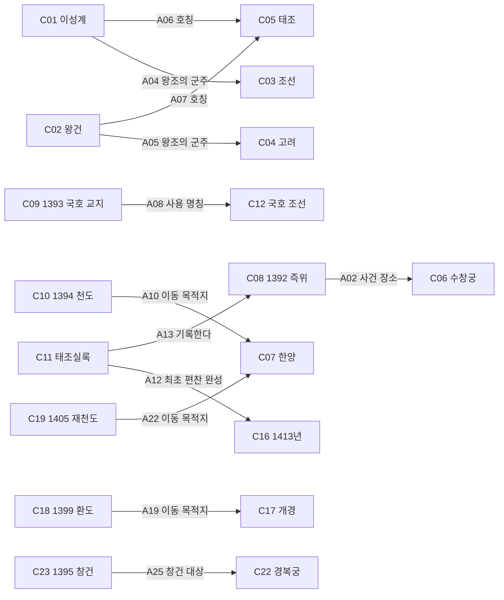

# 한국 역사 온톨로지 — 리비전 2

[ontology.json](ontology.json)이 정본이며 이 문서는 같은 데이터를 읽기 좋게 펼친 것이다. 개념은 타입에 속한 인물·왕조·장소·사건·명칭·문헌·시점 인스턴스다. OWL/RDF 추론기가 아니라 조건과 출처를 명시한 타입 그래프다.

위키의 `concept_ids`·`claim_ids`는 아래 ID를 그대로 사용한다. `current`는 제한된 문장과 출처가 대응한다는 운영 상태이며 역사적 사실의 절대 확실성을 뜻하지 않는다. 특히 A09는 S003에 표시된 역일의 보고이고 CF1은 미해결이다.

## 주요 관계 보기

화살표에 적힌 관계만 읽는다. 공간 그림의 배치가 시간 순서나 인과를 뜻하지 않는다.

## 타입

| ID | 이름 | 정의 |
| --- | --- | --- |
| T-person | 인물 | 개별 역사적 인물. 지위와 이름 문자열은 별도이다. |
| T-polity | 정치체·왕조 | 이번 모델에서 역사적으로 특정한 왕조를 지칭한다. 시대 일반이나 현대 민족국가와 동일시하지 않는다. |
| T-place | 장소 | 사료에서 특정한 역사적 장소. 현대 행정 경계를 자동 부여하지 않는다. |
| T-event | 사건 | 누가 언제 어디서 무엇을 했는지 조건을 가진 발생 단위. |
| T-label | 호칭·명칭 | 다른 개체들이 공유할 수 있는 이름 문자열. |
| T-document | 문헌 | 사건을 기록하는 텍스트와 그 편찬 이력을 가진 대상. |
| T-date | 시점 | 역법과 정밀도를 명시한 시점. ISO 양력 날짜로 자동 변환하지 않는다. |

## 개념과 개체

| ID | 이름 | 타입 | 정의 / 날짜 정밀도 |
| --- | --- | --- | --- |
| C01 | 이성계 | T-person | S005에서 초명 성계로 설명하는 조선 태조. |
| C02 | 왕건 | T-person | S006에서 이름 왕건으로 설명하는 고려 태조. |
| C03 | 조선 왕조 | T-polity | 이성계가 개창한 왕조. C12의 명칭 문자열과 구별한다. |
| C04 | 고려 왕조 | T-polity | S006에서 왕건을 제1대 왕으로 설명하는 왕조. |
| C05 | 태조 | T-label | 문헌과 왕조 맥락에 따라 지시 인물이 달라지는 호칭. 그 자체는 인물이 아니다. |
| C06 | 수창궁 | T-place | S002 즉위 기사에 명시된 궁궐. |
| C07 | 한양 | T-place | S004 천도 목적지의 역사적 지명. 현대 서울의 행정 경계와 동일한 개체로 확장하지 않는다. |
| C08 | 1392년 즉위 | T-event | S002에 기록된 조선 태조의 수창궁 즉위 사건. |
| C09 | 1393년 국호 자문 전달과 사용 교지 | T-event | S003 기사의 자문 전달 및 국호 사용 교지. 해외 조칙 발급일·후대 해제 서술과 구별한다. |
| C10 | 1394년 한양 천도 | T-event | S004에 기록된 한양으로의 천도 사건. 영구 수도 상태를 뜻하지 않는다. |
| C11 | 태조실록 | T-document | 태조대 사건을 서술하며 뒤에 편찬·개수된 문헌. |
| C12 | 조선이라는 국호 | T-label | 정치체 C03에 쓰는 이름 문자열. 다른 시대의 동명 명칭과 자동 병합하지 않는다. |
| C13 | 1392년·원자료 7월 17일 | T-date | S002의 기사 역일. 현대 양력으로 환산하지 않았다. calendar=source-lunisolar; precision=day |
| C14 | 1393년·원자료 2월 15일 | T-date | S003의 기사 역일. S005의 3월 서술과 차이가 있으며 현대 양력 미환산. calendar=source-lunisolar; precision=day |
| C15 | 1394년·원자료 10월 25일 | T-date | S004의 기사 역일. 현대 양력으로 환산하지 않았다. calendar=source-lunisolar; precision=day |
| C16 | 1413년 최초 편찬 완성 | T-date | S005에 따른 최초 편찬 완성 연도. 현전본의 모든 문장이 이때 확정되었다는 뜻이 아니다. calendar=year-correspondence; precision=year |
| C17 | 개경 | T-place | S007에서 1399년 환도의 목적지로 설명하는 역사적 장소. |
| C18 | 1399년 개경 환도 | T-event | 1394년 천도와 구별되는 개경으로의 환도 사건. |
| C19 | 1405년 한양 재천도 | T-event | S007에서 설명하는 한양으로 다시 천도한 사건. C10과 다름. |
| C20 | 1399년 | T-date | S007의 환도 연도. 자료의 3월 표기는 출처 카드에 보존하고 모델은 연도 단위로 제한. calendar=year-correspondence; precision=year |
| C21 | 1405년 | T-date | S007의 재천도 연도. 월·일 미부여. calendar=year-correspondence; precision=year |
| C22 | 경복궁 | T-place | S008이 설명하는 궁궐 장소. 한양 C07 자체나 특정 현존 부재와 동일하지 않다. |
| C23 | 1395년 경복궁 창건 | T-event | S008의 소개와 역사 표가 창건으로 구분한 사건. 천도 C10과 구별. |
| C24 | 1395년 | T-date | S008의 창건 연도. 양력 월·일이나 공사 전 기간을 의미하지 않음. calendar=year-correspondence; precision=year |

## 관계 종류

이번 관계는 모두 비대칭·비전이로 취급한다. 역방향 조회는 가능하지만 의미가 같은 역관계 사실을 자동 생성하지 않는다.

| ID | 관계 | 주어 타입 → 목적어 타입 | 정의 / 조건 |
| --- | --- | --- | --- |
| R01 | 주요 인물 | T-event → T-person | 해당 사건에 이 역할로 등장하는 인물. 모든 참여자 목록은 아님. |
| R02 | 사건 장소 | T-event → T-place | 사건이 발생한 장소. 이동 목적지는 R03으로 구별. |
| R03 | 이동 목적지 | T-event → T-place | 해당 천도 사건의 도착지. 영구 수도 상태를 함의하지 않음. |
| R04 | 기사 시점 | T-event → T-date | 이 사건을 기록한 기사에 표시된 역일. 현대 양력 동치 금지. |
| R05 | 왕조의 군주 | T-person → T-polity | 조건에 적힌 왕조의 군주. 모든 시기의 동일 역할을 뜻하지 않음. |
| R06 | 호칭 | T-person → T-label | 해당 문헌/왕조 맥락에서 쓰인 인물 호칭. 역방향은 다대일 가능. |
| R07 | 사용 명칭 | T-event → T-label | 국호 사용 교지가 지정한 명칭. 정치체 자체와 구별. |
| R08 | 최초 편찬 완성 | T-document → T-date | 최초 편찬 완료 시점. 사건일이나 최종 개수일이 아님. |
| R09 | 기록한다 | T-document → T-event | 문헌이 사건을 서술함. 서술된 동기·평가를 모두 사실로 승인하지 않음. |
| R10 | 대상 왕조 | T-event → T-polity | 해당 사건이 다루는 왕조. 사건의 모든 정치적 원인을 설명하지 않음. |
| R11 | 자료에 제시된 사건 시점 | T-event → T-date | 기관 해설·연표가 제시한 사건 시점. 실록 기사의 역일 R04와 구별하고 시점 정밀도를 유지한다. |
| R12 | 창건 대상 | T-event → T-place | 이 창건 사건이 다루는 궁궐 장소. 수도 이동 목적지나 현재 모든 건축 부재의 연대를 뜻하지 않는다. |

## 출처가 있는 주장

| 주장 | 주어 → 관계 → 목적어 | 성립 조건 | 근거 |
| --- | --- | --- | --- |
| A01 | C08 · 1392년 즉위 → R01 · 주요 인물 → C01 · 이성계 | S005의 인물 정의와 연결한 즉위 기사 | [S002](sources/S002.md) · 태조실록 1권, 태조 1년 7월 17일 첫째 기사; 국역 첫 문장과 말미; [S005](sources/S005.md) · 1절 편찬 및 개수 경위; 2절 태조 인적 사항과 건국·국호 단락 |
| A02 | C08 · 1392년 즉위 → R02 · 사건 장소 → C06 · 수창궁 | 1392년 즉위 장소 | [S002](sources/S002.md) · 태조실록 1권, 태조 1년 7월 17일 첫째 기사; 국역 첫 문장과 말미 |
| A03 | C08 · 1392년 즉위 → R04 · 기사 시점 → C13 · 1392년·원자료 7월 17일 | 원자료 역일 그대로; 양력 미환산 | [S002](sources/S002.md) · 태조실록 1권, 태조 1년 7월 17일 첫째 기사; 국역 첫 문장과 말미 |
| A04 | C01 · 이성계 → R05 · 왕조의 군주 → C03 · 조선 왕조 | 조선 태조라는 왕조 맥락 | [S005](sources/S005.md) · 1절 편찬 및 개수 경위; 2절 태조 인적 사항과 건국·국호 단락 |
| A05 | C02 · 왕건 → R05 · 왕조의 군주 → C04 · 고려 왕조 | 고려 제1대 왕; 재위 918~943 | [S006](sources/S006.md) · 내용 요약·정의·가계 및 인적사항 |
| A06 | C01 · 이성계 → R06 · 호칭 → C05 · 태조 | 조선 왕조 맥락에서의 묘호 | [S005](sources/S005.md) · 1절 편찬 및 개수 경위; 2절 태조 인적 사항과 건국·국호 단락 |
| A07 | C02 · 왕건 → R06 · 호칭 → C05 · 태조 | 고려 왕조 맥락에서의 호칭 | [S006](sources/S006.md) · 내용 요약·정의·가계 및 인적사항 |
| A08 | C09 · 1393년 국호 자문 전달과 사용 교지 → R07 · 사용 명칭 → C12 · 조선이라는 국호 | 국호 사용 교지의 내용 | [S003](sources/S003.md) · 태조실록 3권, 태조 2년 2월 15일 첫째 기사; 한상질의 자문 전달과 경내 교지 |
| A09 | C09 · 1393년 국호 자문 전달과 사용 교지 → R04 · 기사 시점 → C14 · 1393년·원자료 2월 15일 | S003 기사 표기를 보고한 주장; S005의 월 표기 차이는 CF1로 미해소 | [S003](sources/S003.md) · 태조실록 3권, 태조 2년 2월 15일 첫째 기사; 한상질의 자문 전달과 경내 교지 |
| A10 | C10 · 1394년 한양 천도 → R03 · 이동 목적지 → C07 · 한양 | 1394년의 천도 사건에 한정. 이후 영구 지속은 주장하지 않음 | [S004](sources/S004.md) · 태조실록 6권, 태조 3년 10월 25일 첫째 기사; 국역 |
| A11 | C10 · 1394년 한양 천도 → R04 · 기사 시점 → C15 · 1394년·원자료 10월 25일 | 원자료 역일 그대로; 양력 미환산 | [S004](sources/S004.md) · 태조실록 6권, 태조 3년 10월 25일 첫째 기사; 국역 |
| A12 | C11 · 태조실록 → R08 · 최초 편찬 완성 → C16 · 1413년 최초 편찬 완성 | 최초 편찬 완성. 뒤의 개수가 없었다는 뜻이 아님 | [S005](sources/S005.md) · 1절 편찬 및 개수 경위; 2절 태조 인적 사항과 건국·국호 단락 |
| A13 | C11 · 태조실록 → R09 · 기록한다 → C08 · 1392년 즉위 | 해당 기사의 서술 존재 | [S002](sources/S002.md) · 태조실록 1권, 태조 1년 7월 17일 첫째 기사; 국역 첫 문장과 말미 |
| A14 | C08 · 1392년 즉위 → R10 · 대상 왕조 → C03 · 조선 왕조 | 해제 2절의 왕조 개창 설명 | [S005](sources/S005.md) · 1절 편찬 및 개수 경위; 2절 태조 인적 사항과 건국·국호 단락 |
| A15 | C10 · 1394년 한양 천도 → R10 · 대상 왕조 → C03 · 조선 왕조 | 해제 2절의 조선 태조 천도 설명 | [S005](sources/S005.md) · 1절 편찬 및 개수 경위; 2절 태조 인적 사항과 건국·국호 단락 |
| A16 | C09 · 1393년 국호 자문 전달과 사용 교지 → R10 · 대상 왕조 → C03 · 조선 왕조 | 국호 사용 교지의 대상 | [S003](sources/S003.md) · 태조실록 3권, 태조 2년 2월 15일 첫째 기사; 한상질의 자문 전달과 경내 교지 |
| A17 | C11 · 태조실록 → R09 · 기록한다 → C09 · 1393년 국호 자문 전달과 사용 교지 | 해당 기사의 서술 존재 | [S003](sources/S003.md) · 태조실록 3권, 태조 2년 2월 15일 첫째 기사; 한상질의 자문 전달과 경내 교지 |
| A18 | C11 · 태조실록 → R09 · 기록한다 → C10 · 1394년 한양 천도 | 해당 기사의 서술 존재 | [S004](sources/S004.md) · 태조실록 6권, 태조 3년 10월 25일 첫째 기사; 국역 |
| A19 | C18 · 1399년 개경 환도 → R03 · 이동 목적지 → C17 · 개경 | 1399년 환도 사건의 목적지. 모든 주민의 이주 완료를 뜻하지 않음 | [S007](sources/S007.md) · 조선의 건국과 시전 상인: 항시 설명 말미의 1399년 환도 및 다음 문단의 1405년 재천도 |
| A20 | C18 · 1399년 개경 환도 → R11 · 자료에 제시된 사건 시점 → C20 · 1399년 | 해설에 제시된 연도 수준. 정확한 현대 양력 날짜 미확인 | [S007](sources/S007.md) · 조선의 건국과 시전 상인: 항시 설명 말미의 1399년 환도 및 다음 문단의 1405년 재천도 |
| A21 | C18 · 1399년 개경 환도 → R10 · 대상 왕조 → C03 · 조선 왕조 | 조선 정부의 환도라는 자료 맥락 | [S007](sources/S007.md) · 조선의 건국과 시전 상인: 항시 설명 말미의 1399년 환도 및 다음 문단의 1405년 재천도 |
| A22 | C19 · 1405년 한양 재천도 → R03 · 이동 목적지 → C07 · 한양 | 1405년 재천도 사건의 목적지. 이후의 모든 수도 상태를 명제화하지 않음 | [S007](sources/S007.md) · 조선의 건국과 시전 상인: 항시 설명 말미의 1399년 환도 및 다음 문단의 1405년 재천도 |
| A23 | C19 · 1405년 한양 재천도 → R11 · 자료에 제시된 사건 시점 → C21 · 1405년 | 해설에 제시된 연도만 저장. 월·일 미확인 | [S007](sources/S007.md) · 조선의 건국과 시전 상인: 항시 설명 말미의 1399년 환도 및 다음 문단의 1405년 재천도 |
| A24 | C19 · 1405년 한양 재천도 → R10 · 대상 왕조 → C03 · 조선 왕조 | 조선 정부의 한양 재천도라는 자료 맥락 | [S007](sources/S007.md) · 조선의 건국과 시전 상인: 항시 설명 말미의 1399년 환도 및 다음 문단의 1405년 재천도 |
| A25 | C23 · 1395년 경복궁 창건 → R12 · 창건 대상 → C22 · 경복궁 | 창건 대상 궁궐. 한양이라는 도시 자체와 구별 | [S008](sources/S008.md) · 경복궁 소개 첫 문단 및 역사 표의 1395년 경복궁 창건 행 |
| A26 | C23 · 1395년 경복궁 창건 → R11 · 자료에 제시된 사건 시점 → C24 · 1395년 | 기관 소개의 창건 연도. 정확한 착공일·모든 현존 부재의 제작일 아님 | [S008](sources/S008.md) · 경복궁 소개 첫 문단 및 역사 표의 1395년 경복궁 창건 행 |
| A27 | C23 · 1395년 경복궁 창건 → R10 · 대상 왕조 → C03 · 조선 왕조 | 조선왕조의 법궁이라는 자료 맥락 | [S008](sources/S008.md) · 경복궁 소개 첫 문단 및 역사 표의 1395년 경복궁 창건 행 |

## 질문과 범위

| ID | 질문 | 상태 | 기원 / 이유 |
| --- | --- | --- | --- |
| Q1 | 즉위·국호 사용 교지·한양 천도는 같은 사건인가? | answered | synthetic-user · R1~R2 |
| Q2 | 원자료 날짜를 현대 양력 날짜로 읽어도 되는가? | answered | synthetic-user · R5 |
| Q3 | 고려 태조와 조선 태조는 같은 인물인가? | answered | synthetic-user · R3 |
| Q4 | 태조실록의 사건일과 문헌 편찬일은 같은가? | answered | synthetic-user · R4 |
| Q5 | 1394년 이후 한양이 계속 수도였는가? | answered | synthetic-user · R2·R7에서 나온 확장 질문; cycle-01에서 기관 자료를 읽고 답변 및 반례 검토 |
| Q6 | 경복궁 창건과 한양 천도는 같은 사건·연도인가? | answered | synthetic-user · R1·R5·R7에서 나온 확장 질문; cycle-01에서 기관 자료를 읽고 답변 및 반례 검토 |
| Q7 | 왕조 교체가 당시 모든 주민의 삶에 미친 영향은? | deferred | synthetic-user · 사회집단별 별도 근거가 필요하여 이번 씨앗에서 제외 |
| Q8 | S003의 2월 15일과 S005의 3월 표기 차이는 왜 생겼는가? | deferred | source-review · 역법/오류를 추정으로 확정하지 않고 추가 연구로 남김 |

## 미해결과 추론 제한

CF1: S003 기사와 S005 해제의 국호 변경 월 표기 차이. 연도는 일치하지만 차이의 원인은 이번 모델에서 알 수 없다. Q8로 보류하며 어느 한쪽의 월을 통합 정답으로 만들지 않는다.

- 이름이 같다는 이유로 인물을 합치지 않는다.
- 선후관계만으로 인과를 만들지 않는다.
- 천도 사건에서 영구 수도 상태를 추론하지 않는다.
- 기록에 적힌 발언을 속마음의 확정 사실로 변환하지 않는다.
- 없음은 기본적으로 미확인이다.

[위키로 돌아가기](README.md) · [실제 질문 응답 검토](verification/question-checks.md)
