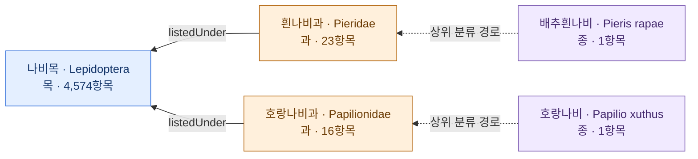
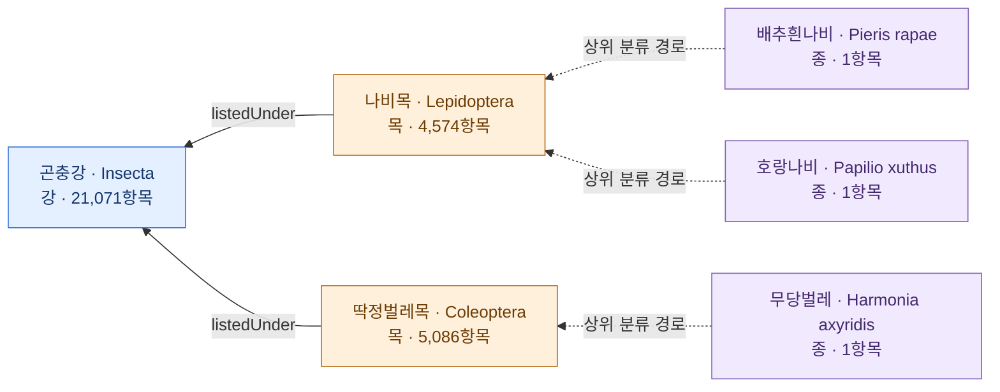
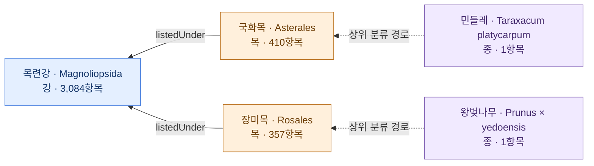
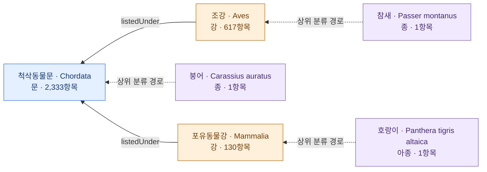
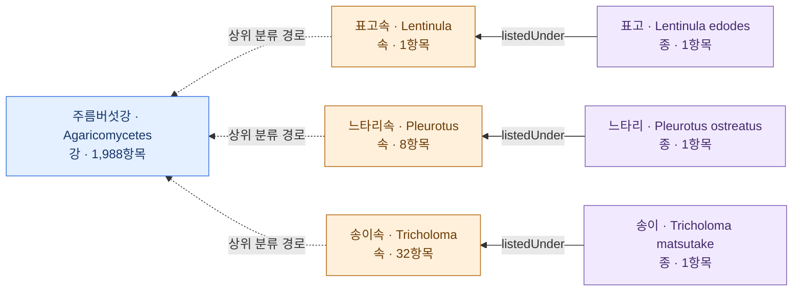
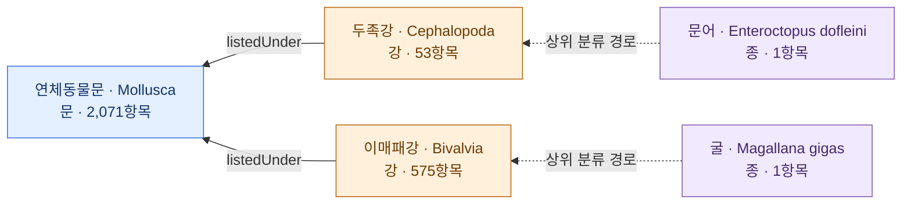

# 생물종 Galaxy Graph 3D

[3D 갤럭시 그래프 열기](index.html) · [2D 분류 경로](paths.html) · [기본 비교](../REPORT.md) · [대규모 비교](../large-scale/REPORT.md)

62,604개 목록 항목에서 만든 89,801개 노드와 89,718개 고유 분류 관계를 바탕으로 합니다. 같은 관계의 출처별 기록은 315,866개입니다.

마스터의 기존 [Galaxy Graph 3D](https://github.com/DECK6/obsidian-galaxy-graph)의 별빛·후광·배경 입자 시각 효과를 재사용했습니다. 전체 모드는 실제 89,801개 노드와 89,718개 고유 관계를 3D로 표시합니다. 회전·이동·확대, 국명·학명·KTSN 검색, 선택한 노드의 주변 관계 강조, 질문별 경로 보기를 지원합니다. 배경의 미세 입자는 장식이며 데이터 노드 수에 포함하지 않습니다.

3D 좌표는 관계를 보기 위한 배치이며, 생태적·진화적 거리나 실제 지리 좌표를 뜻하지 않습니다. 아래 Mermaid 관계도와 별도 2D 화면은 질문별 경로와 문·강 요약입니다.

아래 Mermaid·2D 화면의 화살표는 하위 → 상위입니다. 실선 `listedUnder`는 원본에 기재된 가장 가까운 상위 분류군, 점선은 중간 노드를 접은 상위 경로입니다. 3D 화면에서는 노드 상세 정보로 방향을 확인합니다. 원본에 없는 계급을 보충하거나 생물학적 즉시 부모를 추론하지 않았습니다. 노드를 선택하면 ID·목록 항목 수·출처 행을 확인할 수 있습니다.

파랑은 공통 범위, 주황은 제외 분류군, 보라는 기준 생물종, 초록은 제외 후 집계한 과입니다. 집계 과의 수는 해당 질문에서 제외 조건을 적용한 값이며, 전체 데이터의 과별 항목 수와 구분합니다.

## l01 · 나비목 · 두 과 제외 · 상위 8과

배추흰나비·호랑나비의 가장 낮은 공통 상위 분류군 아래에서 두 나비 각각의 과를 제외하세요. 제외 후 전체 목록 항목 수를 구하고, 남은 과 중 항목이 50개 이상인 과를 항목 수 내림차순(동률은 학명 오름차순)으로 상위 8개 골라 과별 항목 수와 서로 다른 속 수를 제시하세요.

범위 **4,574항목** − 제외 **39항목** = 남은 **4,535항목**. 남은 항목 중 과 미확정 **0항목**.

| 제외 후 상위 과 | 항목 수 | 서로 다른 속 수 |
|---|---:|---:|
| Geometridae | 730 | 288 |
| Noctuidae | 670 | 261 |
| Erebidae | 533 | 213 |
| Tortricidae | 486 | 134 |
| Crambidae | 337 | 134 |
| Gelechiidae | 221 | 67 |
| Pyralidae | 168 | 87 |
| Nymphalidae | 132 | 49 |

표 밖의 나머지 과: 1,258항목. 과 미확정: 0항목. 둘 다 남은 전체 총계에 포함합니다.

## l02 · 곤충강 · 중복 목 제외 · 상위 10과

배추흰나비·호랑나비·무당벌레의 가장 낮은 공통 상위 분류군 아래에서 세 곤충 각각의 목을 제외하세요. 중복되는 목은 한 번만 제외합니다. 제외 후 전체 목록 항목 수를 구하고, 남은 과 중 항목이 100개 이상인 과를 항목 수 내림차순(동률은 학명 오름차순)으로 상위 10개 골라 과별 항목 수와 서로 다른 속 수를 제시하세요.

범위 **21,071항목** − 제외 **9,660항목** = 남은 **11,411항목**. 남은 항목 중 과 미확정 **1항목**.

| 제외 후 상위 과 | 항목 수 | 서로 다른 속 수 |
|---|---:|---:|
| Braconidae | 1,361 | 240 |
| Ichneumonidae | 1,133 | 344 |
| Chironomidae | 526 | 113 |
| Aphididae | 513 | 159 |
| Cicadellidae | 400 | 168 |
| Miridae | 329 | 125 |
| Tenthredinidae | 288 | 73 |
| Syrphidae | 257 | 76 |
| Limoniidae | 212 | 47 |
| Crabronidae | 198 | 46 |

표 밖의 나머지 과: 6,193항목. 과 미확정: 1항목. 둘 다 남은 전체 총계에 포함합니다.

## l03 · 쌍떡잎식물 · 두 목 제외 · 상위 10과

민들레·왕벚나무의 가장 낮은 공통 상위 분류군 아래에서 두 식물 각각의 목을 제외하세요. 제외 후 전체 목록 항목 수를 구하고, 남은 과 중 항목이 20개 이상인 과를 항목 수 내림차순(동률은 학명 오름차순)으로 상위 10개 골라 과별 항목 수와 서로 다른 속 수를 제시하세요.

범위 **3,084항목** − 제외 **767항목** = 남은 **2,317항목**. 남은 항목 중 과 미확정 **0항목**.

| 제외 후 상위 과 | 항목 수 | 서로 다른 속 수 |
|---|---:|---:|
| Fabaceae | 169 | 52 |
| Ranunculaceae | 147 | 21 |
| Lamiaceae | 120 | 29 |
| Apiaceae | 108 | 43 |
| Brassicaceae | 104 | 35 |
| Scrophulariaceae | 98 | 29 |
| Caryophyllaceae | 96 | 21 |
| Polygonaceae | 92 | 10 |
| Violaceae | 64 | 1 |
| Rubiaceae | 56 | 14 |

표 밖의 나머지 과: 1,263항목. 과 미확정: 0항목. 둘 다 남은 전체 총계에 포함합니다.

## l04 · 척삭동물문 · 조강·포유강 제외

참새·붕어·호랑이의 가장 낮은 공통 상위 분류군 아래에서 참새와 같은 강 및 호랑이와 같은 강에 속한 항목을 모두 제외하세요. 붕어의 강은 제외하지 않습니다. 제외 후 전체 목록 항목 수를 구하고, 남은 과 중 항목이 10개 이상인 과를 항목 수 내림차순(동률은 학명 오름차순)으로 상위 10개 골라 과별 항목 수와 서로 다른 속 수를 제시하세요.

범위 **2,333항목** − 제외 **747항목** = 남은 **1,586항목**. 남은 항목 중 과 미확정 **0항목**.

| 제외 후 상위 과 | 항목 수 | 서로 다른 속 수 |
|---|---:|---:|
| Gobiidae | 87 | 44 |
| Cyprinidae | 78 | 38 |
| Scorpaenidae | 51 | 19 |
| Cottidae | 40 | 20 |
| Carangidae | 37 | 18 |
| Tetraodontidae | 32 | 5 |
| Serranidae | 31 | 12 |
| Labridae | 28 | 17 |
| Pleuronectidae | 27 | 16 |
| Stichaeidae | 26 | 15 |

표 밖의 나머지 과: 1,149항목. 과 미확정: 0항목. 둘 다 남은 전체 총계에 포함합니다.

## l05 · 주름버섯강 · 세 속 제외 · 상위 10과

표고·느타리·송이가 함께 속한 강을 범위로 삼아, 세 버섯 각각의 속을 제외하세요. 가장 낮은 공통 분류군이 아니라 공통 강 전체가 범위입니다. 제외 후 전체 목록 항목 수를 구하고, 남은 과 중 항목이 20개 이상인 과를 항목 수 내림차순(동률은 학명 오름차순)으로 상위 10개 골라 과별 항목 수와 서로 다른 속 수를 제시하세요. 과 정보가 없는 항목은 전체 총계에는 포함하되 과별 집계에서 분리해 미확정 수로 제시하세요.

범위 **1,988항목** − 제외 **41항목** = 남은 **1,947항목**. 남은 항목 중 과 미확정 **5항목**.

| 제외 후 상위 과 | 항목 수 | 서로 다른 속 수 |
|---|---:|---:|
| Russulaceae | 188 | 3 |
| Entolomataceae | 119 | 3 |
| Agaricaceae | 105 | 19 |
| Boletaceae | 102 | 24 |
| Polyporaceae | 98 | 36 |
| Marasmiaceae | 82 | 18 |
| Amanitaceae | 77 | 2 |
| Hymenochaetaceae | 70 | 19 |
| Psathyrellaceae | 61 | 10 |
| Mycenaceae | 55 | 9 |

표 밖의 나머지 과: 985항목. 과 미확정: 5항목. 둘 다 남은 전체 총계에 포함합니다.

## l06 · 연체동물문 · 두 강 제외 · 상위 10과

문어·굴의 가장 낮은 공통 상위 분류군 아래에서 두 동물 각각의 강을 제외하세요. 제외 후 전체 목록 항목 수를 구하고, 남은 과 중 항목이 20개 이상인 과를 항목 수 내림차순(동률은 학명 오름차순)으로 상위 10개 골라 과별 항목 수와 서로 다른 속 수를 제시하세요.

범위 **2,071항목** − 제외 **628항목** = 남은 **1,443항목**. 남은 항목 중 과 미확정 **0항목**.

| 제외 후 상위 과 | 항목 수 | 서로 다른 속 수 |
|---|---:|---:|
| Pyramidellidae | 83 | 35 |
| Buccinidae | 68 | 15 |
| Muricidae | 49 | 24 |
| Bradybaenidae | 44 | 14 |
| Epitoniidae | 44 | 11 |
| Naticidae | 43 | 13 |
| Ovulidae | 40 | 17 |
| Trochidae | 35 | 15 |
| Eulimidae | 28 | 15 |
| Nassariidae | 26 | 6 |

표 밖의 나머지 과: 983항목. 과 미확정: 0항목. 둘 다 남은 전체 총계에 포함합니다.
